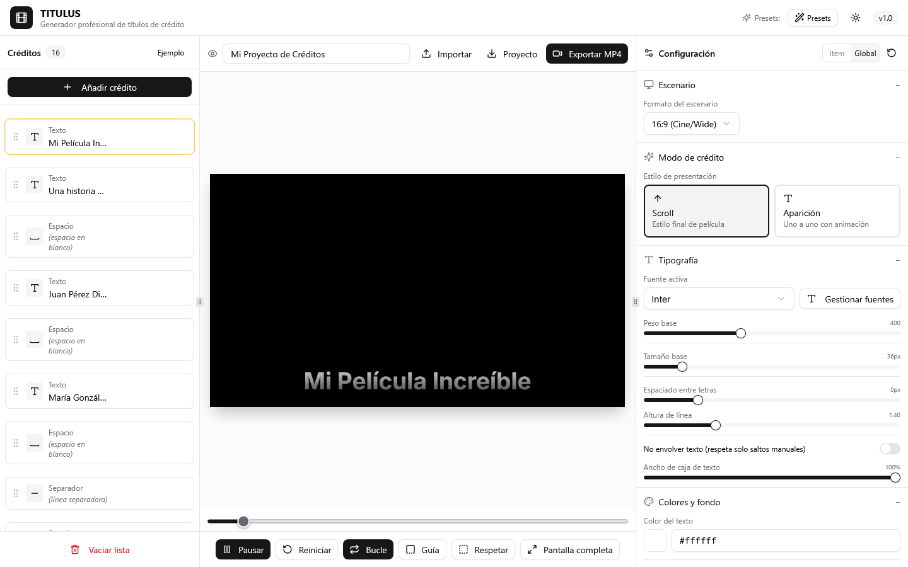
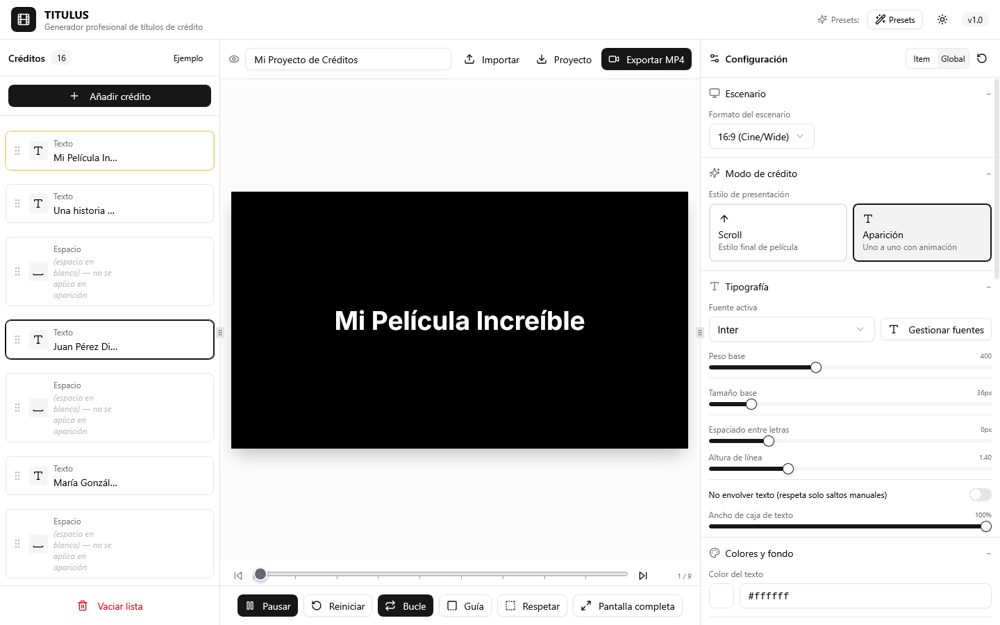
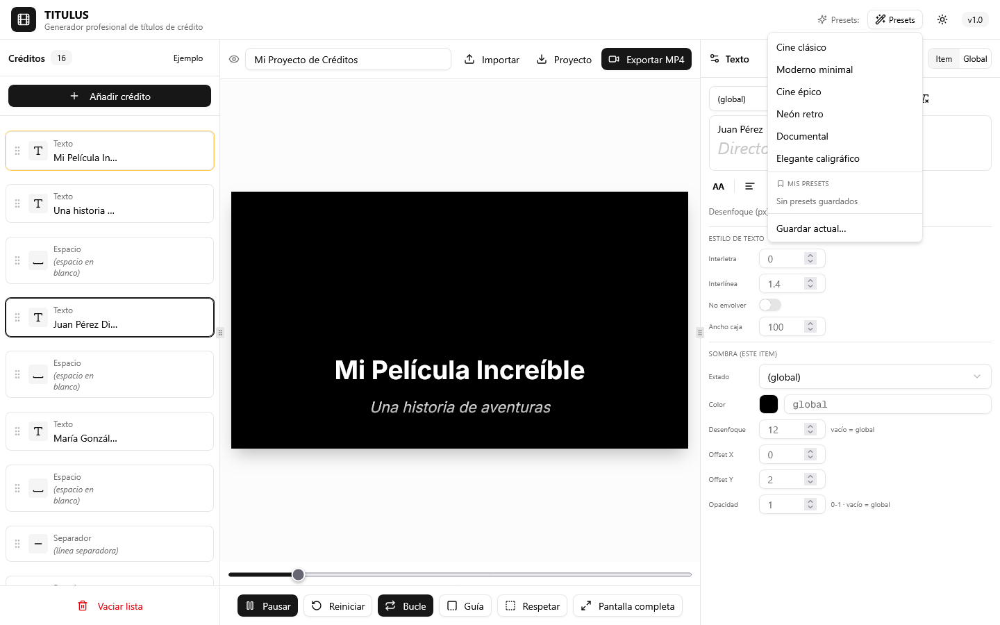
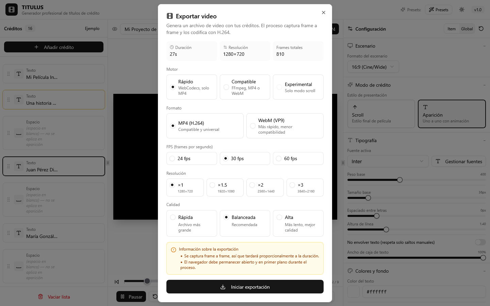

# Guía de titulus

Cómo se usa titulus para montar los títulos de crédito de un vídeo. El [README](../../README.md) lista todo lo que hace la app; esta página es un recorrido corto.

Abre https://memoriainfinita.github.io/titulus/. Todo se hace en el navegador: el proyecto vive en el cliente y nada se sube a ningún servidor.

## La pantalla

- **Créditos**, a la izquierda: la lista de ítems, que se reordenan arrastrando. **Añadir crédito** añade uno; **Ejemplo** carga el proyecto de muestra; **Vaciar lista** borra todo
- **Vista previa**, en el centro: con la línea de tiempo debajo y los botones Pausar, Reiniciar, Bucle, Guía (márgenes seguros), Respetar (que los márgenes seguros limiten el contenido) y Pantalla completa
- **Configuración**, a la derecha: lo que afecta a todo el proyecto, o a un ítem si lo seleccionas

El nombre del proyecto está arriba, sobre la vista previa, con **Importar** y **Proyecto** (exportar como JSON).

## Elegir el modo

En «Modo de crédito» hay dos estilos:

- **Scroll**: los créditos suben de abajo arriba, como el final de una película
- **Aparición**: los elementos aparecen uno a uno con una animación (fade, slide, zoom, blur o máquina de escribir), con revelado línea a línea opcional

## Escribir los créditos

Cada ítem de la lista es un texto, un espacio, un separador o una imagen. Selecciona uno y la configuración de la derecha pasa a **Item**: ahí editas su texto, con fuente, tamaño, negrita, cursiva y color por fragmento, y puedes cambiar solo para él la alineación, la sombra, el desenfoque o la animación. **Global** vuelve a lo común.

Donde un campo dice «vacío = global», dejarlo vacío significa que usa el valor del proyecto.

## Fuentes y estilo

Bajo **Global**: el formato del escenario (16:9, 21:9, 4:3, 9:16 o 1:1), la fuente (de Google Fonts, del sistema o un archivo tuyo, con **Gestionar fuentes**), el tamaño, los colores y el fondo, las sombras y la viñeta, la alineación y los separadores.

## Presets

El botón **Presets** de arriba ofrece estilos hechos (Cine clásico, Moderno minimal, Cine épico, Neón retro, Documental, Elegante caligráfico) y **Guardar actual…** para guardar el tuyo en el navegador.

## Exportar el vídeo

**Exportar MP4** abre el diálogo de exportación.

- **Motor**: *Rápido* (WebCodecs, solo MP4) o *Compatible* (FFmpeg, MP4 o WebM); hay además uno *Experimental*, solo para el modo scroll. El diálogo avisa si tu navegador no admite el rápido
- **Formato**: MP4 (H.264) o WebM (VP9); **FPS**: 24, 30 o 60; **Resolución**: de ×1 a ×3 sobre el escenario; **Calidad**
- La exportación captura el vídeo cuadro a cuadro, así que tarda en proporción a la duración y el navegador debe seguir abierto y en primer plano
